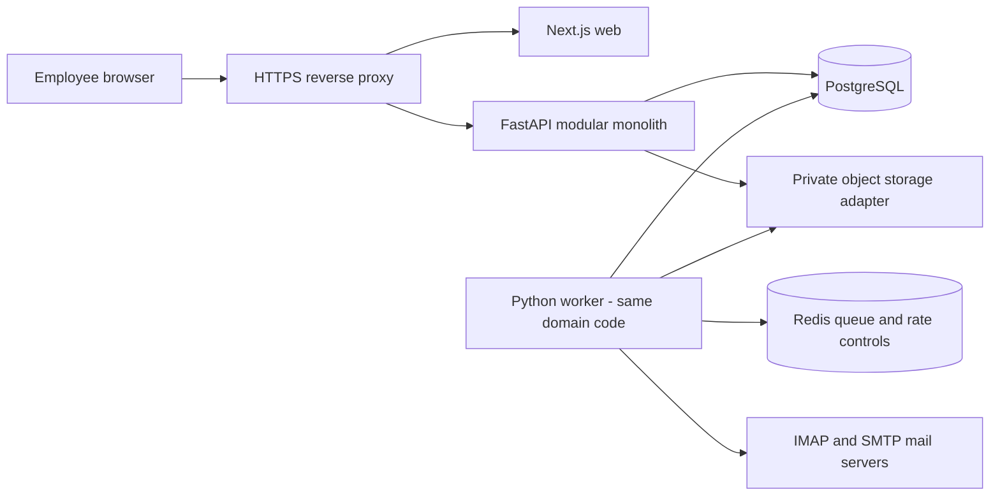

# Architecture and behavior ownership

Baseline: modular monolith, ADR-0001. Stack candidates follow the master spec:
Next.js/strict TypeScript, Tailwind/shadcn, React Hook Form/Zod, TanStack Query;
FastAPI/Pydantic, SQLAlchemy 2/Alembic, PostgreSQL FTS/GIN, Redis and Python
worker. Versions/native wheels, job library, image digests and object storage
are conditional on support, security and target-VM validation, not homologated.

Browser and API share one origin. Proxy routes `/api/v1` to API and page traffic
to web. SSR forwards the authenticated request context with no shared user cache.
No business writes in Next.js actions bypass API authorization. Worker is a
separate process of the monolith, not a microservice with its own data model.
PostgreSQL owns durable state and event truth. Redis may be lost/rebuilt without
losing business events. A private local filesystem storage adapter is acceptable
for early development; a production S3-compatible implementation must pass the
CPU/security gate. No storage product is assumed preinstalled.

## Applied Foundation worker

ADR-0017 selects Dramatiq 2.2.1 and redis-py 8.1.0 without native extras, plus
Redis 7.4.12 built with x86-64-v1 flags. One worker process reuses the API image
and domain code, with a dispatcher and two consumer threads. It projects existing
identity/team events into durable administrative history; no mail, storage or
ticket automation worker is implied. PostgreSQL still owns rate controls and
authoritative events; Redis is transport only. Scoped worker grants are distinct
from API credentials, and the browser has no database or Redis secret.

Actual applied schema, operational recovery and acceptance are recorded in
data-model.md, ADR-0017 and docs/phase-1-closure-evidence.md. The full-product diagram
above remains a phased design contract rather than an assertion that future
components already exist.

## Module boundaries

| Owner | Responsibilities and permitted collaboration |
| --- | --- |
| identity/teams | Credentials, sessions, scope grants, memberships, policy evaluation |
| clients/projects | Client/contact and project scope; default project validation |
| work_items | State machine, parent/dependency invariants, owner/participants, comments |
| tickets | Ticket number, requester, queue, assignment/state, conversation visibility |
| email | MIME ingestion, verified correlation, durable delivery, mailbox checkpoints |
| automation | Schema-validated rules, stable logical keys, execution ledger and triage |
| sla | Versioned policy/calendar, immutable timing events and breach calculation |
| analytics | Read queries over authorized datasets, no write authority over source modules |
| audit/notifications | Transactional audit/activity and scoped notification delivery |
| infrastructure | Database sessions, storage, transport, clock and queue adapters |
| import | Source staging, approved mapping revisions, transactional reconciliation |

Use existing domain functions within the same Python application; do not add
network services or interfaces with a single speculative use. Each write is
owned by its aggregate service. Cross-module behavior calls that service and
its policy checks, not an endpoint issuing unchecked writes to another module.
Repository layout is created only as each phase needs it.

## Transaction boundaries and failures

API authenticates, validates payload, loads policy-filtered resources, checks
expected version and performs mutation + history + audit + outbox in a single
PostgreSQL transaction. Publish occurs after commit. Rollback leaves no event.
No remote SMTP/storage action is held inside that database transaction.

Upload is a staged process: bounded streaming to quarantine, scan/type check,
then authorized metadata/link commit. On failure, inaccessible orphan is tracked
for cleanup. No user download is possible until ready. Database/files are backed
up against a consistent attachment manifest (never a bucket-only backup).

Outbox dispatcher leases pending events with `FOR UPDATE SKIP LOCKED`; durable
attempt state and lease expiry recover crashes. Redis is a transport hint;
reconciliation republishes undelivered outbox events. Consumers transactionally
deduplicate and commit the business effect. See ADR-0004 for replay semantics.

Ticket email ingress records durable mailbox identity and raw-message hash
before advancing UID checkpoints. Parsing/correlation failures quarantine with
safe metadata and alerting; no retry loop logs message bodies. Egress has a
stable Message-ID. SMTP acknowledgement loss is an ambiguous delivery, not
proof of failure; review before uncertain resend. See ADR-0005.

## Read invariants

Policy predicates apply before results, counts, FTS ranking, linked previews,
notifications or exports. Aggregate counts never reveal hidden records. Search
uses Postgres FTS and GIN, optionally pg_trgm only after native validation.
Private notes are not indexed into public search text. Cursor pagination uses
a deterministic tie-breaker; indexes match actual authorized filters.

Resource ID guessing never reveals another client's name, existence, attachment
or linked title. Relation creation requires read/link authority on both ends
and same client; internal projects cannot be linked to client tickets initially.
Scope-changing writes with existing links are refused until links are reviewed.

## Evolution and operations

Alembic migrations are reviewed in expand/backfill/validate/contract order.
Separate application DB credentials from migration credentials. Rollback restores
the previous image only while schema-compatible; destructive reversal requires
backup and explicit approval. No generated production migration is run in Phase 0.

Compose will isolate postgres/redis/storage on private networks with persistent
volumes, non-root application users, health/readiness, restart policies and
resource limits. Only HTTPS proxy is public. Logs are structured with correlation
IDs, metrics exclude customer bodies. Deployment and Zammad cutover require
separate user authorization and tested rollback.
