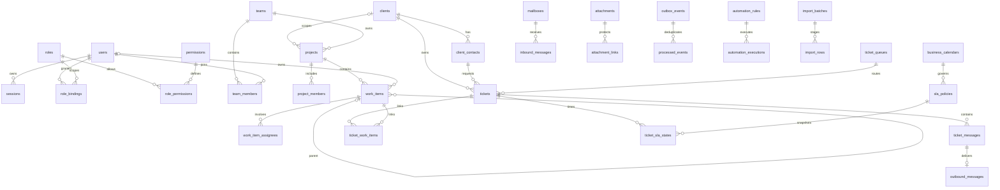

# Data model and planned migrations

Design contract for the complete product. Applied development schema is limited
to the identity and team/idempotency Alembic migrations; other tables below
remain planned. Execution evidence is in the Phase 1/1C reports, not this ERD.
UUID primary keys unless stated. Timestamps
are TIMESTAMPTZ in UTC; business calendars name an IANA timezone. Mutable
aggregates have positive integer version and created_at/updated_at. State
values use CHECK constraints for incremental migration, not silent free text.

Diagram shows core cardinalities. Table definitions below also cover supporting
entities. Dotted operational domains are not implied shared authorization.

## Identity and scope

| Table | Essential columns and database guarantees |
| --- | --- |
| users | id, email_normalized UNIQUE, display_name, password_hash nullable for future OIDC, active, auth_version; no source-name provisioning |
| sessions | id, user_id FK, token_hash UNIQUE, csrf_hash, created/expires/last_seen/revoked_at; opaque token never stored plaintext |
| teams/team_members | team UUID/name/active/version/created_at/updated_at; PK(team_id,user_id), active membership with timestamps; identity roster never grants content access |
| roles/permissions/role_permissions | Stable unique names; PK(role_id,permission_id); role changes audited |
| role_bindings | user_id, role_id, scope_type, nullable client/project/team/queue FKs; CHECK matches exactly one scope or permitted global platform role; unique binding indexes for nullable scopes |
| client_access_grants | PK(user_id,client_id), granted_by, created_at; explicit ceiling on access to that client's content |
| idempotency_records | actor_id, route, key, request_hash, resource/status/result, expires_at; UNIQUE(actor_id,route,key); no sensitive response body unless encrypted/restricted |

Applied Phase 1C-c role_bindings is deliberately narrower than the complete-product
table above: UUID id, user_id/role_name FKs, scope_kind, nullable team_id FK.
CHECK permits only global/platform_admin without team or team/viewer and
team/operations_manager with team. Partial UNIQUE(user_id,role_name) for global
and UNIQUE(user_id,role_name,team_id) for team plus a user lookup index preserve
global semantics and allow repeated role names on distinct teams. Client/project/
queue scope and client_access_grants remain unimplemented; no polymorphic scope
ID or placeholder operational entities were introduced. ADR-0010 owns this slice.

Contact and internal-user identities are distinct. OIDC subject/issuer mapping
is deferred until IdP is known; never join accounts by unverified email alone.
`client_access_grants` is an intentional addition to make the client's ceiling
explicit and prevent team/project grants from revealing another client.

## Projects and work

| Table | Essential columns and invariants |
| --- | --- |
| clients | name, active, default_project_id nullable; default must belong to same client via deferred trigger/check service plus DB trigger |
| client_contacts | client_id, display_name, email_normalized, verification_state; UNIQUE(client_id,email_normalized), never global identity equality |
| operational_areas | name UNIQUE, active; project classification, not a security grant |
| projects | client_id nullable, scope_kind internal/client, team_id, area_id nullable, name, active; CHECK internal has no client and client scope has client_id |
| project_members | PK(project_id,user_id); membership alone cannot override client ceiling |
| project_milestones | project_id, title, due_at, state; Phase 2 after basic work |
| work_items | project_id NOT NULL, parent_id nullable, owner_id nullable, title 1..300, description, status, work_type, priority, due_at, due_date_local nullable DATE, due_precision date/instant, due_timezone, started_at, completed_at, completion_time_known, blocked_reason, estimated_minutes >=0, version |
| work_item_assignees | PK(work_item_id,user_id), participant_role; owner stored separately, visible involvement total counts distinct users |
| work_item_external_participants | work_item_id, client_contact_id nullable, unresolved_label; CHECK known contact XOR unresolved label; no automatic login rights |
| work_item_dependencies | PK(item_id,depends_on_id), no self-reference or cycle; both ends same project initially |
| work_item_comments | work_item_id, author_id nullable, body, source/import_row_id nullable, visibility internal; imported authors may be unknown |
| work_item_status_history | work_item_id, from/to, actor_id nullable, occurred_at nullable, recorded_at, source_precision; immutable |
| time_entries | user_id, work_item_id nullable, ticket_id nullable, minutes >0, entry_date, note; CHECK exactly one target; P1 |

Work status is todo/in_progress/blocked/done/cancelled; type one_off/ongoing.
No recurrence scheduling in MVP. blocked requires nonblank blocked_reason.
Only transitions into done set completed_at for new live mutations. Imports can
have unknown historical completed_at, with completion_time_known=false and source
provenance. Active work must have no current completed_at. Previous completions
remain in immutable history on reopen. Ongoing cannot become done without an
explicit end-of-operation decision. Unknown owner is nullable, not a fake user.

Date-only due_at is the **exclusive start of the next local day**, and
due_date_local retains the source date. Comparisons use due_precision/timezone.
due_at is null iff there is no deadline. Date precision requires a local date and
timezone; instant precision requires an ISO instant. No stored days_remaining.

Parent must be same project. Enforce `(parent_id, project_id)` composite FK
against unique `(id, project_id)`, self-reference CHECK and cycle trigger.
Concurrent graph writes take a project-level transactional advisory lock before
cycle detection, preventing two transactions creating A->B and B->A. Apply the
same ordering/lock to dependencies; do not rely only on Python validation.

## Tickets, communication and files

| Table | Essential columns and invariants |
| --- | --- |
| ticket_queues | name, team_id, active, mailbox/default policy nullable |
| ticket_categories | name, queue_id nullable, active |
| tickets | number BIGINT identity UNIQUE (gaps allowed), client_id, requester_id, queue_id, category_id nullable, assignee_id nullable, subject 1..300, description, status, priority, source, sla_policy_id nullable, first_response_at/resolved_at/closed_at nullable, version |
| ticket_participants | ticket_id + contact_id UNIQUE; contact must belong to same client |
| ticket_messages | ticket_id, author_user_id/contact_id nullable, direction inbound/outbound/internal, visibility public/internal, body_text, sanitized_html, message_id, received_at/sent_at, delivery_status; exactly one author except audited system actor |
| ticket_status_history | ticket_id, from/to, actor_id, occurred_at, reason, policy_version; append-only |
| ticket_work_items | PK(ticket_id,work_item_id), relation_type implements/related, created_at/by; same non-null client enforced by DB trigger |
| attachments | storage_key UNIQUE opaque, sha256, original_filename, media_type, bytes, state quarantine/ready/rejected, uploader_id, scan_result/version |
| attachment_links | attachment_id plus exactly one concrete message/work_comment target FK; UNIQUE target/link; target ACL dominates, no public bucket ACL |
| mailboxes | address UNIQUE, queue_id, IMAP/SMTP host/port/TLS mode, secret_reference, UIDVALIDITY/checkpoint; never password in table/log |
| inbound_messages | mailbox_id, uidvalidity, uid, message_id, raw_hash, raw_storage_key, state, ticket_message_id; UNIQUE(mailbox_id,uidvalidity,uid) |
| outbound_messages | ticket_message_id UNIQUE, stable message_id UNIQUE, envelope recipients snapshot, delivery_state, attempts, next_attempt_at, last_safe_error, accepted_at |

Requester/contact composite FK ensures same client as ticket. Ticket/work/client
scope-changing operations revalidate all links under row locks. Queue transitions
recheck assignee membership. Internal notes cannot create outbound deliveries.
Attachment links cannot be moved to a broader ACL without explicit reauthorization.
Polymorphic attachment/event identifiers never replace actual FK checks.

## SLA, durable processing and provenance

| Tables | Contract |
| --- | --- |
| business_calendars/holidays | IANA timezone, weekly windows, revision, holiday DATE; validate ordered nonoverlapping windows |
| sla_policies | client/category/priority selector, calendar revision, response/resolution minutes >0, pause states, immutable revision |
| ticket_sla_states | ticket_id, cycle_number, policy/calendar snapshot, accumulated elapsed, pause state, next breach; UNIQUE(ticket_id,cycle_number); first response only on accepted public agent response |
| automation_rules | schema_version, trigger, bounded JSON conditions/actions, revision, enabled, scope; no Python/JS/SQL expressions |
| automation_executions | rule_id/revision, event_id, immutable action_id UUID, logical_effect_key UNIQUE, state, work_item_id, attempts, safe_error |
| outbox_events | event_id UUID, aggregate_type/id/version, event_type/schema_version, bounded payload, occurred_at, correlation_id, status, attempts >=0, next_attempt_at, lease_until |
| processed_events | PK(consumer,event_id), processed_at; inserted in same transaction as business effect |
| activity_events | aggregate reference, actor nullable, event type, occurred_at nullable, recorded_at, source_period_label/source_column/import_row_id; separate weekly period from actual instant |
| audit_logs | actor/system identity, action, typed target FK/reference, occurred_at, correlation_id, allowed field diff; append-only restricted writer; no secrets or entire message bodies |
| notifications | recipient_id, source_event_id, channel, state, preferences; UNIQUE(recipient_id,source_event_id,channel), recheck access at delivery/read |
| import_batches | source_system/file_hash/sheet, mapping_version, reference_date/timezone, state, actor, approved_at, counts |
| import_rows | source_system/file_hash/sheet/row UNIQUE, batch_id, original_payload restricted JSON, mapping_version, resolution_status/reason, created_work_item_id nullable; raw and normalized values distinct |

Bounded deduplication for Message-ID/content is separate from UID identity;
legitimate repeated content is not dropped just because hashes match. ADR-0005
defines collision quarantine. Stable task creation key is rule + action + ticket,
not event/version alone. See ADR-0004 for logical replay across reassignment.

## Indexes, deletion and migrations

Initial indexes: normalized user email/session token; grants(user,client);
project(client,team); work(project,status,due_at,id), owner/status/id and assignee
reverse lookup; ticket(client,queue,status,assignee,id), unique number; message
(ticket,received_at,id); outbox partial(status,next_attempt_at) for pending;
mailbox identity uniques; audit(target,time); import provenance unique.
FTS indexes are GIN per authorized searchable public/body scope, with internal
notes separated. No pg_trgm until demonstrated necessary and CPU-tested.

FKs default RESTRICT for operational/audit data. Deactivate accounts/clients;
do not cascade-delete ticket history, messages or evidence. Retention/deletion
policy is awaiting management, so no destructive TTL job is authorized.

| Planned migration batch | Phase | Prerequisite and verification |
| --- | --- | --- |
| identity + sessions + scoped grants + audit/idempotency/outbox kernel | 1 | Empty DB upgrade, constraints, auth/ACL, downgrade on disposable DB |
| clients/contacts/areas/projects/members/work/history | 2 | Composite scope FKs, cycles under concurrency, optimistic versions, restart persistence |
| queues/tickets/messages/files/mailboxes/delivery | 3 | Requester scope, private download, UID/replay, quarantine |
| links/rules/executions/processed consumers | 4 | Same-client trigger, stable effect key, restart/race/replay |
| calendars/SLA/import/analytics indexes | 5 | Reference-date reconciliation, mapping revisions, rollback dry-run |
| time tracking/export/advanced planning | after core | Separate P1/P2 scope, no precreated unused tables |

Outbox kernel starts in Phase 1 for consistent writes; ticket automation consumers
arrive in Phase 4. Every migration has backup/compatibility/rollback notes before
production. No SQL/Alembic migration or database change is executed by this design.
